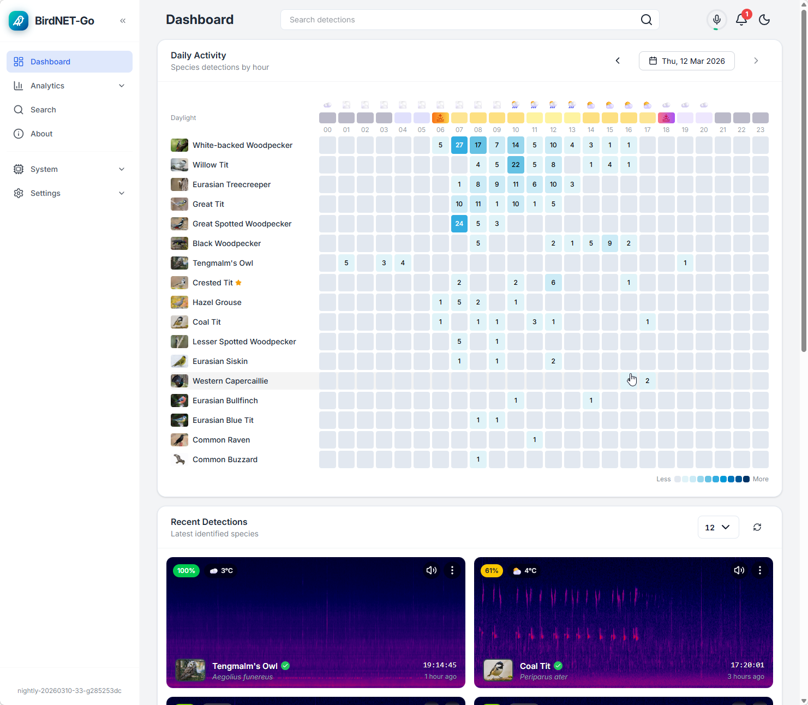

# BirdNET-Go

<p align="center">
  
</p>
<p align="center">
  <!-- Project Status -->
  <a href="https://github.com/tphakala/birdnet-go/releases">
    
  </a>
  <a href="https://creativecommons.org/licenses/by-nc-sa/4.0/">
    
  </a>
  

  <br>

  <!-- Code Quality -->
  <a href="https://golang.org">
    
  </a>
  <a href="https://scorecard.dev/viewer/?uri=github.com/tphakala/birdnet-go">
    
  </a>

  <br>

  <!-- Community -->
  <a href="https://github.com/tphakala/birdnet-go/network/members">
    
  </a>
  <a href="https://github.com/tphakala/birdnet-go/graphs/contributors">
    
  </a>
  <a href="https://github.com/tphakala/birdnet-go/issues">
    
  </a>
  <a href="https://discord.gg/gcSCFGUtsd">
    
  </a>

  <a href="https://coderabbit.ai">
    
  </a>
</p>

**24/7 self-hosted AI sound monitor for birds, bats, and other wildlife.**

BirdNET-Go listens continuously to local microphones or network audio streams, identifies species locally using BirdNET, Google Perch, and bat AI models, and presents detections, spectrograms, and recordings in a fast web dashboard. Runs smoothly on a Raspberry Pi, mini PC, or home server.

## Highlights

- **In-app AI model gallery**: Install BirdNET v2.4, BirdNET+ v3.0 (global and 44 regional models), Google Perch v2, BattyBirdNET, BSG-BAT, and BirdNET Geomodel v3.0 right from the web UI, with no rebuild required.
- **Multi-model, multi-source analysis**: Run several classifiers in parallel across local sound cards and RTSP streams, see per-model match scores on every detection, and optionally require cross-model consensus.
- **Fast detection review and audio cleanup**: Review everything on one page with species correction, alternate predictions, keyboard shortcuts, and built-in clip denoising for playback or saved files.
- **Native audio and live spectrograms**: Pure Go clip encoding, decoding, and spectrogram rendering (no SoX needed; FFmpeg is only required for RTSP streams), plus live browser spectrograms and detection heatmaps.
- **Flexible alerts and smart-home integrations**: Route detections via alert rules to Discord, Slack, Telegram, ntfy, Pushover, Gotify, Matrix, webhooks, browser push, MQTT (with Home Assistant discovery), shell scripts, and BirdWeather.
- **Local-first and built for 24/7 operation**: Installable PWA with 40+ species languages, onboarding wizard, OIDC/SSO and persistent browser sessions, System Health diagnostics, Database Doctor, and strictly opt-in Sentry telemetry.

## Quick install

- **Debian, Ubuntu, and Raspberry Pi OS:**
  ```bash
  curl -fsSL https://github.com/tphakala/birdnet-go/raw/main/install.sh -o install.sh
  bash ./install.sh
  ```
- **Docker, Portainer, and Unraid:** Multi-arch images (`linux/amd64`, `linux/arm64`) are published with host networking recommended. See the [installation guide](https://github.com/tphakala/birdnet-go/wiki/installation), the [Docker Compose guide](https://github.com/tphakala/birdnet-go/wiki/docker_compose_guide) (`Docker/docker-compose.host.yml` or the **BirdNET-Go (host network, recommended)** Portainer template), and the [Unraid README](Unraid/README.md) (note: the Unraid host template is untested on real Unraid; bridge mode remains supported).
- **Pre-built binaries:** Standalone archives for Linux, Windows, and macOS ship with every [release](https://github.com/tphakala/birdnet-go/releases).

See the [hardware recommendations](https://github.com/tphakala/birdnet-go/wiki/hardware) and [security guide](https://github.com/tphakala/birdnet-go/wiki/security) before exposing an instance outside your LAN.

## Web Dashboard



## Features

### Detection

- **BirdNET v2.4** (default, embedded, 6,500+ bird species)
- **BirdNET+ v3.0** via ONNX Runtime (11,709 species and 16 non-animal sound classes, global plus 44 regional models)
- **Google Perch v2** via ONNX Runtime (14,795 species across birds, insects, amphibians, and mammals) with taxonomy-based species names
- **BattyBirdNET** (11 regional bat models) and **BSG-BAT** (experimental, 21 European bat species; requires 192 kHz+ capture, 384 kHz recommended)
- **BirdNET Geomodel v3.0** for location-based range filtering (12,012 species)
- **Cross-model detection consensus**: Multi-model hit pooling strengthens valid detections, and an optional `realtime.modelconsensus` filter (config file) can require multiple models to agree
- **Custom classifiers**: Bring your own TFLite model and label set
- **Configurable false-positive filtering**: Deep Detection (repeat confirmation within a configurable pending window, 12 seconds by default), per-species dynamic thresholds, location-based range filter, privacy and dog-bark filters, and an ultrasonic bat post-filter with optional automatic discard of unlikely detections ([guide](https://github.com/tphakala/birdnet-go/wiki/BirdNET-Go-Guide#deep-detection))
- Per-model and per-source confidence thresholds

### Audio inputs

- Sound card capture and RTSP / RTSPS streams, including multiple sources in parallel with independent model assignment
- Sample rates up to 384 kHz for ultrasonic bat detection
- Audio liveness watchdog with tiered recovery for flaky streams
- Stream sample-rate probing and per-model recommendation banners in the UI
- Audio equalizer, clip denoising (on save or on the fly during playback/download), station-wide playback defaults, per-source quiet hours, daylight filter, and extended capture mode

### Interface

- Svelte 5 + TypeScript single-page app, installable as a Progressive Web App (PWA)
- Single-page Detection Details view showing per-classifier match results and confidence values, 24-hour activity and weather context, species correction with alternate predictions, and keyboard shortcuts
- Onboarding wizard for first-run setup
- Live spectrogram visualization for active streams ([live audio streaming](https://github.com/tphakala/birdnet-go/wiki/BirdNET-Go-Guide#live-audio-streaming))
- Detection heatmaps with ONNX-accelerated rendering
- Customizable dashboard layout, color schemes, and a "Currently Hearing" card
- Multiselect and bulk actions on the detections list
- Browser terminal (xterm.js over WebSocket PTY) for in-app administration
- UI languages: English, German, French, Spanish, Portuguese, Dutch, Polish, Italian, Czech, Slovak, Hungarian, Finnish, Swedish, Danish, Norwegian (Bokmål), Latvian
- Species names in 40+ languages

### Alerts and integrations

- Configurable alert rules engine with per-rule conditions, schedules, and delivery targets
- Multi-target delivery via [shoutrrr](https://github.com/nicholas-fedor/shoutrrr): Discord, Slack, Telegram, ntfy, Pushover, Gotify, Matrix, Bark, IFTTT, and more
- Webhooks with custom templates, shell-script hooks, and browser push notifications
- MQTT publishing with Home Assistant auto-discovery
- BirdWeather.com API integration
- Prometheus metrics endpoint
- Live spectrogram and realtime log output for OBS overlays on bird-feeder streams

### Storage and data

- SQLite (default) or MySQL/MariaDB with retry-aware write paths for contention; only tested LTS releases are supported (MySQL 8.4 and 9.7; MariaDB 10.11, 11.4, 11.8, or 12.3), and MySQL Innovation releases are not supported
- Automatic backups with real-time status polling
- Pure Go clip export and native spectrogram rendering (no SoX required; AAC or Opus recommended for compressed clips, lossless FLAC/WAV for ultrasonic bat clips; MP3 supported but discouraged) ([audio formats](https://github.com/tphakala/birdnet-go/wiki/audio-formats))
- Embedded eBird/Clements taxonomy (2,374 genera, 254 families, 11,145 species) for fast offline lookups

### Operations

- System Health diagnostics page covering audio pipeline, models and inference, network, and the datastore
- Database Doctor for diagnosis and schema repair
- Help & Support page with guided bug reporting and one-click support dumps
- Server-side sessions with "Remember this browser" alongside OIDC / SSO (Google, GitHub, and generic providers, including RP-Initiated Logout)
- TLS certificate management UI with transactional writes and backup/restore
- Hot-reload for settings, model installs, and per-source model assignments (no restart)
- Optional, opt-in Sentry telemetry with strict privacy filtering

### Platform

- Linux, Windows, and macOS
- Single static binary with the BirdNET v2.4 TFLite model embedded
- ONNX Runtime 1.31+ (1.32.0 bundled in Docker and release packages) for BirdNET+ v3.0, Perch v2, BattyBirdNET, BSG-BAT, and BirdNET Geomodel v3.0 ([install guide](https://github.com/tphakala/birdnet-go/wiki/ONNX-Runtime-Installation))
- OpenVINO acceleration for Intel CPUs and GPUs on Linux and Windows
- Multi-arch Docker images (`linux/amd64`, `linux/arm64`)
- Runs comfortably on a Raspberry Pi 4 or equivalent 64-bit single-board computer

## Documentation

- [FAQ](https://github.com/tphakala/birdnet-go/wiki/FAQ) - common questions, issues, and workarounds
- [User guide](https://github.com/tphakala/birdnet-go/wiki/BirdNET-Go-Guide)
- [Installation](https://github.com/tphakala/birdnet-go/wiki/installation)
- [Hardware recommendations](https://github.com/tphakala/birdnet-go/wiki/hardware)
- [Audio formats](https://github.com/tphakala/birdnet-go/wiki/audio-formats)
- [ONNX Runtime installation](https://github.com/tphakala/birdnet-go/wiki/ONNX-Runtime-Installation)
- [Detection pipeline](https://github.com/tphakala/birdnet-go/wiki/detection-pipeline)
- [Database Doctor](https://github.com/tphakala/birdnet-go/wiki/Database-Doctor)
- [Training a custom classifier](https://github.com/tphakala/birdnet-go/wiki/Training-a-Custom-Classifier)
- [Cloudflare Tunnel](https://github.com/tphakala/birdnet-go/wiki/cloudflare_tunnel_guide)
- [Security](https://github.com/tphakala/birdnet-go/wiki/security)
- [Telemetry and privacy](https://github.com/tphakala/birdnet-go/wiki/telemetry-privacy)
- [RTSP troubleshooting](https://github.com/tphakala/birdnet-go/wiki/rtsp-troubleshooting)

## Development setup

> See [CONTRIBUTING.md](CONTRIBUTING.md) for the full guide.

```bash
git clone https://github.com/tphakala/birdnet-go.git
cd birdnet-go

# Install Task (if not already installed)
# Linux: sh -c "$(curl --location https://taskfile.dev/install.sh)" -- -d -b /usr/local/bin
# macOS: brew install go-task

task setup-dev    # installs Go 1.27, Node LTS, build tools, linters, Playwright
task              # build
task dev_server   # hot-reload dev server (or: air realtime)
```

## Community

Join the [Discord server](https://discord.gg/gcSCFGUtsd) for support, discussions, and updates.

## Related projects

### Core and extensions

- [BirdNET-Analyzer](https://github.com/birdnet-team/BirdNET-Analyzer): upstream BirdNET project
- [BirdNET-Go Classifiers](https://github.com/tphakala/birdnet-go-classifiers): enhanced BirdNET classifiers with additional species
- [BattyBirdNET-Analyzer](https://github.com/rdz-oss/BattyBirdNET-Analyzer): regional bat classifier models, installable via the in-app gallery
- [BSG-BAT](https://doi.org/10.5281/zenodo.15495676): European bat classifier covering 21 species, installable via the in-app gallery

### Companion tools

- [birda](https://github.com/tphakala/birda): fast CLI for offline bird species detection on existing audio files, using BirdNET and Perch AI models
- [birda-gui](https://github.com/tphakala/birda-gui): desktop GUI for birda (Electron + Svelte 5) for audio analysis, detection browsing, and species visualization
- [birdnet-go-mcp](https://github.com/zax0rz/birdnet-go-mcp): read-only MCP server and CLI for querying BirdNET-Go detections, health metrics, and audio clips from AI assistants or the terminal

### Home Assistant and displays

- [Home Assistant BirdNET-Go Integration](https://github.com/jrx-code/hassio-integration-birdnet): native HACS integration talking directly to BirdNET-Go over REST and SSE (no MQTT bridge needed), with image entities and a Lovelace card
- [HA Bird Card](https://github.com/adamoberley/HABirdDashboard): Home Assistant custom card (HACS) rendering detections as a live woodblock-style collage with audio playback and false-positive review
- [Fugleramme](https://github.com/arnegiacomo/fugleramme): e-ink frame and web kiosk that renders detected birds as a collage of public-domain natural-history illustrations

### Deployment and system integration

- [Cockpit BirdNET-Go](https://github.com/tphakala/cockpit-birdnet-go): web-based system management plugin using the Cockpit framework
- [TrueCharts Helm Chart](https://github.com/trueforge-org/truecharts): community Helm chart for deploying BirdNET-Go on Kubernetes

### Hardware solutions

- [ESP32 BirdNET Mic](https://github.com/Sukecz/esp32-birdnet-mic): ESP32-based RTSP streaming microphone (I2S and PDM)
- [ESP32 Audio Streamer](https://github.com/jpmurray/esp32-audio-streamer): alternative ESP32 RTSP streaming solution
- [M5Stack Atom Echo RTSP Mic](https://github.com/stedrow/birdnetgo-m5stack-atom-echo-rtsp-mic): RTSP audio server for M5Stack Atom Echo, no soldering required
- [M5Stack AtomS3 Lite PDM Mic](https://github.com/matthew73210/birdnetgo-m5stack-AtomS3-Lite-PDM-rtsp-mic): RTSP audio server with MEMS PDM microphone

### Mobile apps

- [BirdEcho](https://github.com/arunrajiah/birdecho): open-source companion app (formerly Perch) with direct LAN `/api/v2` support for BirdNET-Go plus BirdNET-Pi and BirdWeather multi-station monitoring, audio playback, species browser, 14-day chart, Android home-screen widget, offline cache, CSV export, and favorite species notifications. MIT licensed.
- [BirdNET-Go Companion](https://apps.apple.com/us/app/birdnet-go-companion/id6763647186): native iOS companion app on the App Store (with Android in beta; [support](https://crestlab.org/birdnet-go/support)).
- [BirdFeeder](https://github.com/kj7ppk/birdfeeder): open-source Android streaming app that publishes real-time RTSP audio as a BirdNET-Go stream.

## Contributing

Contributions are welcome.

For setup, workflow, and quality gates, see [CONTRIBUTING.md](CONTRIBUTING.md):

- [TL;DR quick start](CONTRIBUTING.md#tldr---quick-start): 5-minute setup
- [Development workflow](CONTRIBUTING.md#development-workflow): hot reload, git hooks, testing
- [License and privacy](CONTRIBUTING.md#license-and-legal): CC BY-NC-SA 4.0, privacy by design

All contributions must follow privacy-by-design principles, the automated code-quality gates, and the CC BY-NC-SA 4.0 license terms.

## Data sources

### Taxonomy data

BirdNET-Go embeds taxonomy data derived from the eBird/Clements Checklist:

- **Source**: [eBird API v2](https://api.ebird.org/v2/ref/taxonomy/ebird)
- **Copyright**: (c) Cornell Lab of Ornithology
- **License**: used under eBird API Terms of Use for non-commercial purposes
- **Attribution**: taxonomy data powered by [eBird.org](https://ebird.org)
- **Coverage**: 2,374 genera, 254 families, 11,145 species

For more information, see the [eBird Taxonomy](https://ebird.org/science/use-ebird-data/the-ebird-taxonomy).

## License

Creative Commons Attribution-NonCommercial-ShareAlike 4.0 International.

## Authors and acknowledgements

Created and maintained by Tomi P. Hakala.

A growing list of community contributors keeps the project moving forward. The current list lives on the [GitHub contributors page](https://github.com/tphakala/birdnet-go/graphs/contributors).

The BirdNET AI model is by the K. Lisa Yang Center for Conservation Bioacoustics at the Cornell Lab of Ornithology in collaboration with Chemnitz University of Technology (Stefan Kahl, Connor Wood, Maximilian Eibl, Holger Klinck).

Google Perch v2 ONNX conversion by [Justin Chuby](https://huggingface.co/justinchuby/BirdNET-onnx). BattyBirdNET bat classifier models by [R.D. Zinck](https://github.com/rdz-oss/BattyBirdNET-Analyzer). BSG-BAT European bat classifier by the [bsg-bat team](https://doi.org/10.5281/zenodo.15495676). BirdNET label translations by Patrick Levin for the BirdNET-Pi project by Patrick McGuire.
