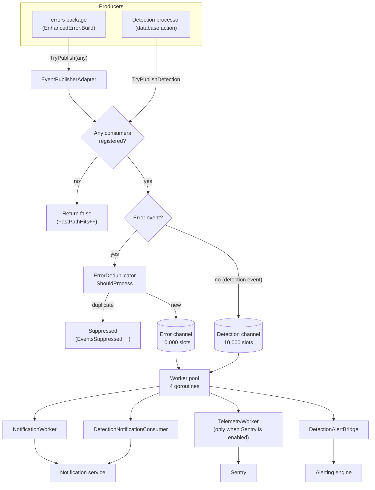

# Event Bus Architecture

This document describes how the `events` package is built and wired into the rest of BirdNET-Go. The bus moves error events and detection events from the code that produces them to the consumers that act on them (notifications, Sentry telemetry, alerting). A producer never waits for a consumer or for queue space. For the API and usage examples see [README.md](README.md).

## Overview

- Producers call `TryPublish` (error events) or `TryPublishDetection` (detection events). Both are non-blocking: an event is either queued or dropped and counted.
- A fixed pool of worker goroutines takes events from the queues and hands each one to the registered consumers.
- When no consumer is registered, publishing is a single atomic load and returns immediately.

The package has no dependency on the packages that produce or consume events. The `errors` package publishes through a small `EventPublisher` interface that the event bus adapter implements, so there is no import cycle.

## Diagram



A full channel drops the event (`EventsDropped++`) instead of waiting.

## Components

### Event bus (`eventbus.go`)

`Initialize(config)` creates the process-wide bus (a second call returns the existing one). `GetEventBus`, `IsInitialized` and `HasActiveConsumers` read its state. The bus owns two buffered channels, one for `ErrorEvent` values and one for `DetectionEvent` values, each with `BufferSize` slots.

`DefaultConfig()` returns a buffer of 10000, 4 workers, deduplication enabled. The application initializes the bus in `internal/telemetry/system_init_manager.go` with its own constants: a buffer of 10000 per channel, 4 workers, and deduplication with a 5 minute TTL, 1000 entries and a 1 minute cleanup interval.

Workers start when the first consumer registers (`RegisterConsumer`), not at `Initialize`. A consumer name must be unique. A consumer that also implements `DetectionEventConsumer` is added to the detection consumer list as well.

Each worker selects on both channels. For an error event it calls `ProcessEvent` on every registered consumer, one after another; for a detection event it calls `ProcessDetectionEvent` on every `DetectionEventConsumer`. A panic in a consumer is recovered and counted in `ConsumerErrors`, and a consumer that takes longer than 100 ms is logged as slow. The bus calls `ProcessEvent` and `ProcessDetectionEvent` only; `ProcessBatch` and `SupportsBatching` are part of the `EventConsumer` interface, but the bus does not batch.

`Shutdown(timeout)` stops accepting events, stops the deduplicator, cancels the workers' context and waits for them up to the timeout. Events still buffered at that point are not guaranteed to be processed. A metrics logger writes a summary every 5 minutes and once at shutdown.

### Fast path

Two checks keep publishing cheap when nothing is listening:

1. A package-level atomic flag (`hasActiveConsumers`) is read first, without locking. If it is false, the call counts a `FastPathHits` and returns false.
2. After the bus state checks, a second check under the bus mutex confirms that at least one consumer exists.

`EventPublisherAdapter.TryPublish` repeats the first check, so an error created while no consumer is registered never reaches the bus.

### Deduplication (`deduplicator.go`)

Only error events are deduplicated, and the check runs on the publishing side, before the event is queued. Detection events are not deduplicated.

The key is a SHA-256 based hash of the component, category and message, plus the `operation`, `error_type` and `provider` context values when present. An event whose key was seen within the TTL is suppressed. The cache is bounded by `MaxEntries` with least-recently-used eviction, and a cleanup goroutine removes expired entries every `CleanupInterval`. `GetDeduplicationStats` reports the counters.

### Consumers

Registered consumers in the application:

| Consumer                        | Package                 | Handles                                                                                                                                      |
| ------------------------------- | ----------------------- | -------------------------------------------------------------------------------------------------------------------------------------------- |
| `NotificationWorker`            | `internal/notification` | Error events, turned into user notifications; has a circuit breaker                                                                          |
| `DetectionNotificationConsumer` | `internal/notification` | Detection events                                                                                                                             |
| `TelemetryWorker`               | `internal/telemetry`    | Error events, reported to Sentry; registered only when Sentry telemetry is enabled. Rate limited, with a circuit breaker and a sampling rate |
| `DetectionAlertBridge`          | `internal/alerting`     | Detection events, forwarded to the alerting engine (its `ProcessEvent` does nothing)                                                         |

Rate limits, circuit breaker thresholds and sampling are properties of each consumer, configured in its own package.

### Errors package integration

`errors.SetEventPublisher` installs the publisher; the application sets it to an `EventPublisherAdapter` right after the bus is initialized. When an `EnhancedError` is built, the errors package publishes it through that interface. If no publisher is set, it falls back to its legacy synchronous reporting path.

### Detection events (`detection_event.go`)

`NewDetectionEvent` validates its input and returns a `DetectionEvent`. The detection processor publishes one per saved detection with `TryPublishDetection`. A dropped detection event is logged at warning level.

### Application event emitter (`emitter.go`)

`Emitter` is separate from the bus: it persists application events to the datastore through the `AppEventStore` interface. It is nil-safe, never returns an error to the caller, and is set once at startup with `SetDefault`.

## Statistics

`GetStats()` returns `EventBusStats`, read with atomic loads:

```go
type EventBusStats struct {
    EventsReceived   uint64 // events accepted into a channel
    EventsSuppressed uint64 // error events removed by deduplication
    EventsProcessed  uint64 // consumer calls that succeeded
    EventsDropped    uint64 // events dropped because a channel was full
    ConsumerErrors   uint64 // consumer errors and recovered panics
    FastPathHits     uint64 // publishes skipped because no consumer is registered
}
```

`EventsProcessed` counts one per consumer call, so it grows by the number of consumers for each event.

## Initialization order

1. `SystemInitManager` calls `events.Initialize` with the configuration above and installs the `EventPublisherAdapter` in the errors package.
2. The notification service registers `NotificationWorker` and `DetectionNotificationConsumer`.
3. Telemetry registers `TelemetryWorker` when Sentry is enabled.
4. The alerting package registers `DetectionAlertBridge` during its own initialization, once the bus exists.
5. The first registration starts the workers. Events published before it are skipped by the fast path.

## Testing and benchmarks

The package tests cover the bus (`eventbus_test.go`), deduplication (`deduplicator_test.go`), the emitter and an end-to-end flow (`integration_test.go`). `mocks/` holds a generated mock of `ErrorEvent`. `benchmark_test.go` measures the fast path, publishing with a consumer, error creation with and without reporting, and `HasActiveConsumers`:

```bash
go test -run '^$' -bench . ./internal/events
```

Use `task test` for the regular test run so the project's build tags are applied.
